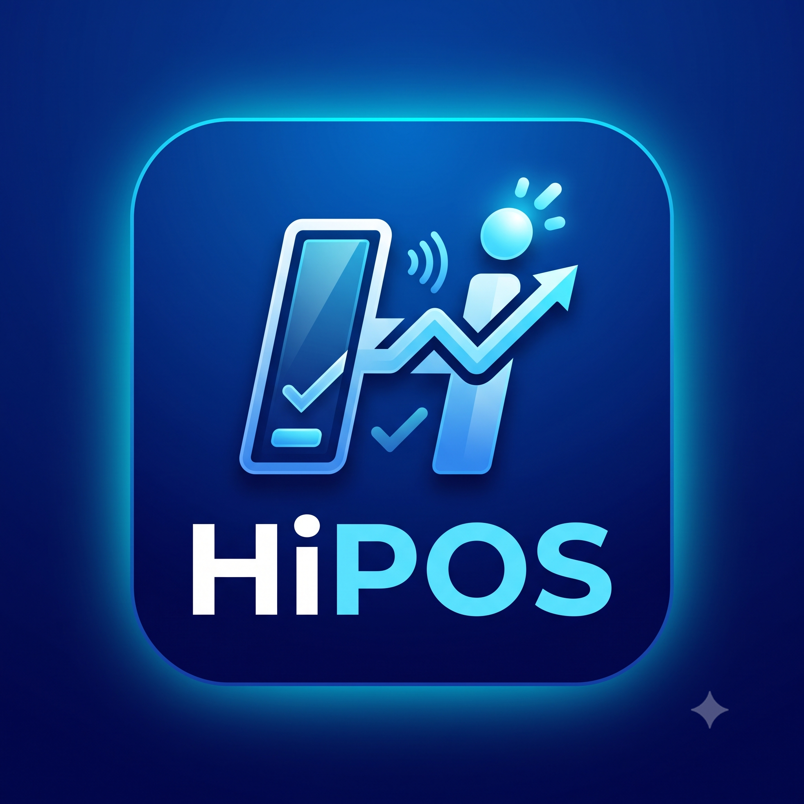

# HiPOS - Hệ Thống Quản Lý Bán Hàng Thông Minh (Smart POS with AI Integration)

<p align="center">
  
</p>

<p align="center">
  <strong>Giải pháp quản lý bán lẻ đa nền tảng kết hợp trí tuệ nhân tạo thế hệ mới</strong>
</p>

<p align="center">
  
  
  
  
  
</p>

---

## 📖 Giới thiệu

**HiPOS** là hệ thống phần mềm quản lý bán lẻ đa nền tảng được xây dựng trên framework **Flutter**, khai thác kiến trúc không máy chủ **Firebase BaaS** (Cloud Firestore, Firebase Authentication) kết hợp sức mạnh phân tích của mô hình đa phương thức **Google Gemini 2.5 Flash**. 

Hệ thống giải quyết toàn diện bài toán tự động hóa quy trình bán hàng, kiểm soát dòng tiền, bóc tách đơn hàng rảnh tay, thẩm định nguồn hàng bao bì và cố vấn chiến lược kinh doanh thông minh cho các mô hình bán lẻ vừa và nhỏ.

---

## 🌟 Tính năng cốt lõi

### 1. Nghiệp vụ quản trị bán lẻ toàn diện
- **Bán hàng:** Lên đơn nhanh chóng qua danh mục sản phẩm trực quan, tìm kiếm thông minh, hỗ trợ đa trạng thái đơn hàng (đơn hoàn thành,đơn lưu tạm ,đơn đặt hàng).
- **Quản lý hàng hóa:** Quét mã vạch tự động, theo dõi biến động số lượng tồn kho theo thời gian thực, thiết lập định mức tồn tối thiểu và tự động cảnh báo sản phẩm sắp hết hàng.
- **Hóa đơn & đổi trả hàng:** Tra cứu lịch sử đơn hàng, xem lại và in ấn hóa đơn chi tiết; xử lý quy trình khách đổi trả hàng thông minh: tự động tính tiền hoàn, cộng lại tồn kho và thu hồi điểm thưởng tương ứng.
- **Báo cáo & tổng quan kinh doanh:** Theo dõi tức thì doanh thu trong ngày, tổng vốn tồn kho, lợi nhuận gộp, biểu đồ cột phân tầng theo mốc thời gian và bảng xếp hạng Top 10 sản phẩm bán chạy nhất.
- **Quản lý khách hàng:** Lưu trữ thông tin khách hàng, phân nhóm (Mặc định, VIP), cơ chế tích lũy và khấu trừ điểm thưởng trực tiếp vào hóa đơn thanh toán.
- **Sổ quỹ & quản lý dòng tiền:** Theo dõi dòng tiền thực tế vào/ra, lập các phiếu thu - chi ngoài luồng bán hàng (tiền điện, mặt bằng, nhập hàng) và đối soát quỹ tiền mặt/ngân hàng.

---

### 2. Đột phá công ghệ & trí tuệ nhân tạo
- **Voice POS Pipeline:** Bóc tách ngôn ngữ tự nhiên tiếng Việt thời gian thực (tự động khử dấu thanh, phân đoạn mệnh đề liên từ, nhận diện từ chỉ số lượng ngữ nghĩa) hỗ trợ lên đơn hàng rảnh tay tại quầy thu ngân.
- **Thanh toán VietQR động chuẩn NAPAS 247:** Tự động sinh chuỗi mã QR chuyển khoản định danh kèm chính xác số tiền cần thu; hỗ trợ luồng thanh toán đa phương thức (kết hợp tiền mặt và quét QR động).
- **Thẩm định nguồn hàng qua Multimodal Vision AI (Gemini Scout):** Chụp ảnh bao bì thực tế để nhận diện thương hiệu, định giá tham chiếu, đánh giá nguy cơ hàng nhái và tự động điền dữ liệu vào form tạo hàng.
- **Toàn vẹn giao dịch:** Sử dụng `WriteBatch` trên Cloud Firestore đảm bảo cập nhật đồng bộ 4 bảng: Hóa đơn (`orders`), trừ kho (`products`), ghi nhận sổ quỹ (`transactions`) và cập nhật điểm thưởng (`customers`) tuân thủ nghiêm ngặt nguyên tắc ACID.
- **Trợ lý Cố vấn chiến lược bán lẻ:** Đàm thoại hai chiều thông minh, tự động tiêm ngữ cảnh vận hành thực tế (doanh thu trong ngày, giá trị vốn tồn kho, danh mục 30 mặt hàng chủ lực) để đưa ra khuyến nghị kinh doanh theo mùa vụ.
- **Gợi ý bán kèm thông minh:** Khi thao tác chọn hàng, AI tự động phân tích giỏ hàng hiện tại đối chiếu với hàng tồn khả dụng trong kho để đề xuất ngay 3 mặt hàng bán kèm phù hợp.
- **Tối ưu hóa tài nguyên:** Áp dụng Cache-Aside Pattern với `SharedPreferences` cho điểm tin kinh doanh hàng ngày, đảm bảo chỉ gọi API 01 lần/ngày, triệt tiêu chi phí hạn mức.
- **Bảo mật giao dịch tài chính nội bộ:** Thiết lập hàng rào xác thực bằng mã PIN 4 chữ số của chủ cửa hàng khi cấu hình tài khoản ngân hàng thụ hưởng, ngăn chặn gian lận tráo mã QR cá nhân.

---

## 🏗️ Kiến Trúc & công nghệ

- **Ngôn ngữ & Framework:** Dart (Sound Null Safety) & Flutter SDK
- **Kiến trúc phần mềm:** Layered Architecture kết hợp mô hình Boundary-Control-Entity (BCE)
- **Cơ sở dữ liệu:** Cloud Firestore (Mô hình phân vùng đa người dùng Multi-tenant: `users/{userId}/*`)
- **Quản lý phiên & xác thực:** Firebase Authentication
- **Trí tuệ nhân tạo:** Google Generative AI SDK (`gemini-2.5-flash`)
- **Bộ nhớ đệm cục bộ:** `shared_preferences`
- **Xử lý âm thanh & iọng nói:** `speech_to_text`
- **Quét quang học:** `simple_barcode_scanner`

---

## 📂 Cấu trúc thư mục (Project Structure)

```text
lib/
├── models/             # Định nghĩa thực thể dữ liệu (Product, Order, Customer,...)
├── services/           # Tầng nghiệp vụ cốt lõi (FirestoreService, AIService)
├── screens/            # Giao diện chức năng (Sales, Payment, Inventory, Overview,...)
├── widgets/            # Thành phần UI dùng chung (ReceiptDialog, PinSecurityDialog,...)
├── utils/              # Tiện ích chuẩn hóa tiếng Việt, định dạng tiền tệ VND
└── main.dart           # Điểm khởi chạy và cấu hình ứng dụng
```

---

## 🚀 Cài Đặt và khởi chạy
### 1. Yêu cầu môi trường
- Flutter SDK $\ge 3.19.0$
- Dart SDK $\ge 3.0.0$
- Công cụ: Android Studio hoặc Visual Studio Code
- Tài khoản Google AI Studio để lấy GEMINI_API_KEY
- Dự án Firebase Console đã kích hoạt Authentication và Firestore

### 2. Cài đặt mã nguồn
```bash
# Clone repository
git clone [https://github.com/hoanghung-oop/HiPOS-SmartRetailSystem.git(https://github.com/hoanghung-oop/HiPOS-SmartRetailSystem.git)
# Di chuyển vào thư mục dự án
cd HiPOS-SmartRetailSystem
# Cài đặt các gói thư viện
flutter pub get
```
### 3. Cấu hình biến môi trường và Firebase
```bash
- Tạo tệp .env tại thư mục gốc và cung cấp khóa API:Đoạn mãGEMINI_API_KEY=your_gemini_api_key_here
- Đặt tệp cấu hình google-services.json tải từ Firebase Console vào đường dẫn:android/app/google-services.json
```
### 4. Khởi chạy ứng dụng
```bash
# Khởi chạy trên thiết bị di động Android
flutter run

# Khởi chạy trên nền tảng Web (bảo mật API Key qua cờ dart-define)
flutter run -d chrome --dart-define=GEMINI_API_KEY=your_gemini_api_key_here
```
